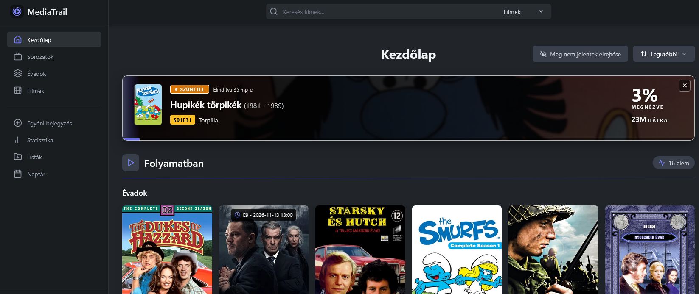

# Most nézem

[English](../now-watching.md)

Amíg egy társalkalmazás játszik vagy szünetel, a MediaTrail a kezdőlap tetején egy vagy több **„Most nézem”** sávot mutathat — eszközönként egyet.

## Mi kell hozzá

- Futó MediaTrail (lásd [Telepítés](install.md)).
- Társalkalmazás: [NuvioMobile-MT](https://github.com/aicon/NuvioMobile-MT) vagy [NuvioTV-MT](https://github.com/aicon/NuvioTV-MT). A hivatalos Nuvio kliensek ezeket a lejátszó eseményeket nem küldik.
- Külön scrobbler konténer nem kell. Az addon a MediaTrail kép része.

## Beállítás

1. A MediaTrailben a **Beállítások → Integrációk → Nuvio** oldalt azzal a fiókkal nyisd meg, amelynél a sávoknak meg kell jelenniük.
2. Másold ki a bővítmény címét (`…/nuvio/<token>/manifest.json`). Ez a cím ehhez a MediaTrail-fiókhoz tartozik.
3. Minden társalkalmazásban a **Beállítások → Bővítmények** alatt add hozzá ezt a címet, és vedd ki a régi scrobbler vagy token nélküli MediaTrail URL-t.
4. Játssz le egy filmet vagy epizódot. Minden eszköz saját sávot kap **azon** a fiókon.

## Több eszközös működés

| Viselkedés | Részlet |
| --- | --- |
| Stabil sorrend | A sávok a megjelenés sorrendjét tartják; a progress nem ugratja előre az eszközt |
| Eszközönként egy sáv | Telefon és két tévé egyszerre is megjelenhet, nem írják felül egymást |
| MediaTrail-fiókonként | A lejátszás az addon URL tokenjét követi; más fiók nem látja a te sávjaidat |
| Automatikus név | A kliens stabil azonosítót és címkét küld, pl. `telefon · Pixel 8` vagy `TV · Shield` |
| Átnevezés | A sáv neve a kezdőlapon átírható; az egyéni név stop és elvetés után is megmarad |
| Pause / stop / elvetés | Csak az adott eszköz sávját érinti |
| Befejezett nézés | Akkor mentődik, ha a kliens `stop`ot küld, és a haladás legalább **90%** |
| Idle takarítás | A progress nélküli watching sáv kb. három perc után, a paused sáv kb. tíz perc után tűnik el. Az üzemeltető ezt a [Környezet](runtime.md) oldalon módosíthatja |

Seek után is mennie kell progressnek, hogy a sáv ne maradjon le. A lejátszóból kilépéskor `stop` kell.

## Nem ugyanaz, mint a Nuvio import

Az [Import](imports.md) ütemezve behozhatja a Nuvio-profil befejezett előzményét. Az az út nem hajtja az élő sávokat, és nem cseréli le az eszközönkénti „Most nézem” sorokat.

A könyvtár áttekintése a [Könyvtár](library.md) oldalon van.
